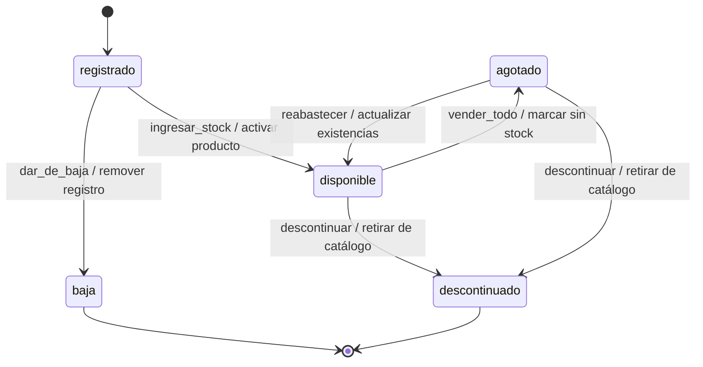

# DTE generado desde el código · Producto

Este archivo lo genera `verificar.py`. No lo editen a mano: si algo está mal, corrijan el archivo de estados y vuelvan a verificar.

Compárenlo con el DTE que dibujaron en diagrams.net. Deben ser el mismo diagrama.

